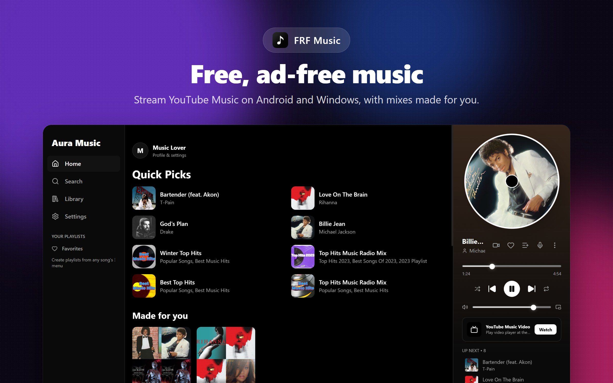
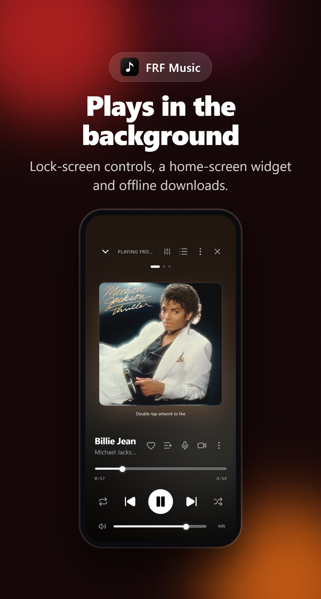

# FRF Music

A free, ad-free music player for **Android** and **Windows** that streams from YouTube Music, with downloads for offline listening.

<p align="center">
  
  
</p>

**Download:** [latest release](https://github.com/zaxslikesu456-ship-it/FRF-Music/releases/latest) (Android APK and Windows EXE)

## Features

- **Streaming and search**: search YouTube Music for songs, artists, albums, videos and community playlists, with autocomplete, recent searches and results from your own library (works offline).
- **Downloads**: save songs and whole playlists for offline listening, with optional auto-download of liked songs.
- **Background playback**: a native player on Android (ExoPlayer) keeps playing with the screen off, with lock-screen and notification controls and a home-screen widget on Android.
- **Sound**:
  - a 5-band equalizer with bass boost and 3D surround;
  - volume normalization;
  - crossfade between songs;
  - Android only: a separate equalizer preset for each headphone.
- **Lyrics**: synced lyrics that follow the song, tap a line to jump, and a shareable lyric card.
- **For you**: daily mixes, a "Rediscover" mix of songs you loved but haven't played in a while, and listening stats (minutes, top artists, streaks). All of this is kept on your device.
- **Playlists**: create, import (share codes, song lists, CSV, Spotify links) and share playlists.
- **Many languages** and themes.

## Building

You need Node.js 20+.

```bash
npm install
npm run build
```

**Android** (needs the Android SDK and JDK 17):

```bash
npx cap sync android
cd android
./gradlew assembleRelease   # phone APK (shrunk, ARM only)
./gradlew assembleDebug     # debug APK with every CPU type (for emulators)
```

**Windows** (needs Rust):

```bash
cd src-tauri
cargo build --release
```


## Project layout

| Path | What it is |
|---|---|
| `src/` | The app (React + TypeScript + Vite), shared by every platform |
| `android/` | Android app (Capacitor) with the native player, equalizer and widget |
| `ios/` | iPhone app (work in progress, not released) |
| `src-tauri/` | Windows app (Tauri) with its audio proxy and token window |

## Disclaimer

FRF Music is an independent project. It is not affiliated with, endorsed by or connected to YouTube or Google. Use it in line with the terms of the services you access through it.

## License

Copyright (C) 2026 zaxs

FRF Music is free software, released under the [GNU General Public License v3.0 or later](LICENSE). You can use, study, share and change it. If you share a changed version, it must stay under the same license and include its source code.

FRF Music includes code and libraries from other projects under their own licenses (MIT, Apache-2.0, BSD, ISC, MPL-2.0 and others). Their copyright notices are in [THIRD_PARTY_NOTICES.txt](public/THIRD_PARTY_NOTICES.txt), which the apps also show under Settings > App info > Open-source licenses. Regenerate it with `node scripts/generate-notices.mjs` after changing libraries.
